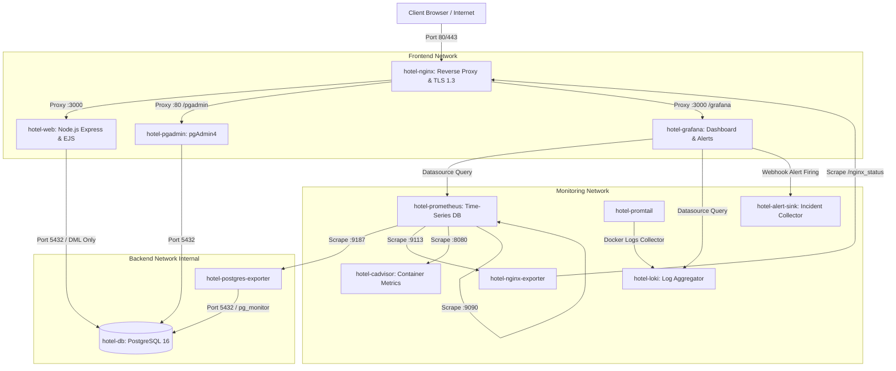

# Hệ Thống Đặt Phòng Khách Sạn (Hotel Booking System)

**Môn học:** Triển khai và Quản trị Hệ thống Phần mềm  
**Học viên thực hiện:** Nông Minh Trí  
**Mã số sinh viên (MSSV):** DTC245200342  
**Repository:** [https://github.com/MinhTris19/DTC245200342-hotel-devops.git](https://github.com/MinhTris19/DTC245200342-hotel-devops.git)  

---

## 1. Giới thiệu dự án
Hệ thống Đặt phòng Khách sạn (Hotel Booking System) là ứng dụng web fullstack đa tầng chạy trên nền tảng Docker với kiến trúc microservices 12 container hoàn chỉnh, phục vụ 3 nhóm đối tượng theo mô hình RBAC:
- **Khách hàng (Customer):** Xem danh mục loại phòng kèm hình ảnh thực tế, tìm kiếm phòng trống theo khoảng ngày nhận/trả phòng và số lượng khách, đặt phòng trực tuyến, theo dõi lịch sử và hủy đặt phòng (khi chưa check-in).
- **Lễ tân (Staff):** Đặt phòng trực tiếp tại quầy (walk-in), xác nhận đặt phòng, thực hiện quy trình Check-in (chuyển trạng thái phòng sang occupied), ghi nhận dịch vụ phát sinh, Check-out và thanh toán xuất hóa đơn, cập nhật trạng thái phòng sau khi dọn dẹp.
- **Quản lý (Manager):** Kế thừa toàn bộ quyền của Lễ tân; quản lý danh mục loại phòng (upload hình ảnh đại diện), quản lý danh sách phòng, quản lý dịch vụ khách sạn, quản trị tài khoản nhân viên (tạo mới, khóa/mở khóa), xem bảng điều khiển KPI doanh thu và tỷ lệ lấp đầy phòng.

---

## 2. Sơ đồ kiến trúc hệ thống (12 Container)



---

## 3. Yêu cầu hệ thống
- **Hệ điều hành:** Ubuntu Server 22.04 LTS hoặc 24.04 LTS (khuyến nghị trên VirtualBox).
- **Phần cứng:** Tối thiểu 2 CPU Cores, 4 GB RAM (khuyến nghị 6 GB RAM), 25 GB ổ cứng trống.
- **Mạng:** Card mạng Bridge Adapter (IP tĩnh hoặc DHCP gia đình), mở cổng 22 (SSH), 80 (HTTP) và 443 (HTTPS).
- **Phần mềm bắt buộc:** Docker Engine 24+, Docker Compose v2, OpenSSL, Git, cURL.

---

## 4. Hướng dẫn cài đặt & Triển khai từ đầu

### Bước 1: Clone mã nguồn từ GitHub
```bash
git clone https://github.com/MinhTris19/DTC245200342-hotel-devops.git ~/hotel
cd ~/hotel
```

### Bước 2: Thiết lập file môi trường bí mật `.env`
Sao chép từ file mẫu `.env.example` và thiết lập mật khẩu mạnh:
```bash
cp .env.example .env
chmod 600 .env
```
*(Chỉnh sửa file `.env` bằng `nano .env` để đặt mật khẩu bảo mật cho CSDL, pgAdmin, Grafana và Session Secret).*

### Bước 3: Khởi tạo chứng chỉ SSL/TLS tự ký cho Nginx
Chạy kịch bản tự động sinh chứng chỉ chuẩn RSA 2048-bit với SAN IP của máy ảo:
```bash
./nginx/gen-cert.sh
```

### Bước 4: Khởi động toàn bộ 12 dịch vụ bằng một lệnh duy nhất
```bash
docker compose up -d --build
```
Kiểm tra trạng thái sẵn sàng của 12 container:
```bash
docker compose ps
```

---

## 5. Bảng thông tin truy cập & Tài khoản mẫu

| Dịch vụ | Địa chỉ URL | Tài khoản mặc định | Ghi chú |
| :--- | :--- | :--- | :--- |
| **Ứng dụng Web Khách Sạn** | `https://<VM_IP>/` | `admin`<br>`letan01`<br>`khach01` | Mật khẩu mẫu thiết lập trong `.env` |
| **Giao diện Giám sát Grafana** | `https://<VM_IP>/grafana/` | `admin` | Mật khẩu mẫu thiết lập trong `.env` |
| **Quản trị CSDL pgAdmin** | `https://<VM_IP>/pgadmin/` | `admin@hotel.com` | Mật khẩu mẫu thiết lập trong `.env` |
| **Prometheus Metrics UI** | `http://localhost:9090` | Không cần mật khẩu | Truy cập an toàn qua SSH Tunnel bên dưới |

> [!NOTE]
> Để bảo mật, cổng 9090 của Prometheus không mở ra ngoài mạng. Mở đường truyền an toàn qua SSH Tunnel bằng lệnh:
> ```bash
> ssh -i ~/.ssh/id_hotel -L 9090:localhost:9090 <SSH_USER>@<VM_IP>
> ```
> Sau đó mở trình duyệt máy tính truy cập `http://localhost:9090/targets`.

---

## 6. Hướng dẫn sử dụng nghiệp vụ theo vai trò (RBAC)

1. **Khách hàng (Customer - `khach01`):**
   - Đăng nhập -> Chọn "Xem & Tìm Phòng".
   - Lọc theo loại phòng, sức chứa hoặc nhập ngày nhận/ngày trả phòng để hệ thống kiểm tra phòng trống.
   - Nhấn "Đặt phòng" -> Nhập số lượng khách và ghi chú -> Nhấn "Xác nhận đặt".
   - Vào mục "Đặt phòng của tôi" để xem trạng thái đơn hoặc nhấn "Hủy đặt" nếu thay đổi kế hoạch.
2. **Lễ tân (Staff - `letan01`):**
   - Nhấn "Tạo đặt phòng tại quầy" cho khách vãng lai.
   - Xem danh sách đặt phòng chờ xử lý -> Nhấn "Xác nhận".
   - Đến ngày nhận phòng -> Nhấn "Check-in" (phòng chuyển sang trạng thái có khách `occupied`).
   - Chọn "Thêm dịch vụ" (Buffet sáng, giặt ủi, spa...) trực tiếp vào hóa đơn của phòng.
   - Khi khách trả phòng -> Nhấn "Check-out & Thanh toán" -> Chọn phương thức thanh toán (tiền mặt/thẻ/QR), nhập số tiền khách trả -> In hóa đơn.
   - Sau khi phòng dọn dẹp xong -> Nhấn "Đánh dấu đã dọn" để phòng trở lại trạng thái sẵn sàng `available`.
3. **Quản lý (Manager - `admin`):**
   - Truy cập "Bảng điều khiển Quản lý" (Dashboard KPI): theo dõi doanh thu hôm nay, tỷ lệ lấp đầy phòng, top dịch vụ phát sinh.
   - Quản lý loại phòng: Thêm loại phòng mới, cập nhật giá và upload hình ảnh minh họa (chỉ chấp nhận `.jpg`, `.png`, `.webp` <= 2 MB).
   - Quản lý danh sách phòng: Khóa phòng bảo trì hoặc mở lại phòng.
   - Quản lý nhân viên: Tạo tài khoản lễ tân mới hoặc khóa tài khoản nhân viên vi phạm.

---

## 7. Giám sát hệ thống & Nhật ký tập trung

### A. Hệ thống Giám sát Prometheus & Dashboards Grafana
Hệ thống tự động tích hợp sẵn 3 Dashboard chuyên sâu tại thư mục "Hotel Monitoring":
1. **Hotel - Containers:** Theo dõi mức tiêu thụ CPU (%), Bộ nhớ RAM, Network I/O và trạng thái của 12 container Docker thông qua cAdvisor.
2. **Hotel - Nginx:** Thống kê lưu lượng kết nối thời gian thực, số lượng active connections, request per second qua Nginx Exporter.
3. **Hotel - PostgreSQL:** Theo dõi số kết nối đang hoạt động, tỷ lệ Cache Hit Ratio, tốc độ giao dịch commit/rollback và dung lượng bảng qua Postgres Exporter.

### B. Nhật ký tập trung Loki & Truy vấn LogQL
Promtail tự động thu thập toàn bộ log container và chuyển tiếp về Loki. Để tra cứu log, mở Grafana -> Explore -> Chọn datasource **Loki**:
- **Q1 (Log Nginx lỗi mã 5xx):** `{job="nginx"} |~ "" 5[0-9]{2} "`
- **Q2 (Lỗi ngoại lệ trên Web App):** `{job="webapp"} |~ "(?i)(error|exception|failed)"`
- **Q3 (Sự kiện đăng nhập thất bại):** `{job="webapp"} |= "LOGIN_FAILED"`
- **Q4 (Tần suất đăng nhập lỗi 1 phút):** `sum(count_over_time({job="webapp"} |= "LOGIN_FAILED" [1m]))`

---

## 8. Kịch bản sự cố An toàn thông tin (Brute Force Detection & Alert)

Hệ thống được trang bị cơ chế tự động phát hiện tấn công vét cạn mật khẩu (Brute Force):
1. **Quy tắc cảnh báo (Grafana Alert Rule):** Luật `Hotel - Brute force login` liên tục quét Loki, nếu phát hiện trên 5 sự kiện `LOGIN_FAILED` trong 1 phút sẽ lập tức chuyển trạng thái sang `Firing`.
2. **Kênh tiếp nhận (Alert Sink):** Cảnh báo tự động gửi Webhook HTTP POST tới dịch vụ `hotel-alert-sink:8080/alert` và ghi nhật ký tại `/var/log/alerts/alerts.log`.
3. **Thực thi mô phỏng tấn công:**
   ```bash
   chmod +x ./scripts/simulate_bruteforce.sh
   ./scripts/simulate_bruteforce.sh
   ```
4. **Kiểm tra phản ứng của hệ thống:**
   - Xem log Nginx trả về mã HTTP `429 Too Many Requests` do Nginx Rate Limiting (`limit_req_zone`).
   - Kiểm tra log cảnh báo nhận được:
     ```bash
     docker logs hotel-alert-sink
     ```

---

## 9. Các biện pháp Hardening Bảo mật đã áp dụng

1. **Non-Root Containers:** Ứng dụng Web chạy với người dùng `node` (UID 1000), Alert Sink chạy với `appuser` (UID 10001), Prometheus/Exporters chạy với `nobody` (UID 65534), Grafana chạy với UID 472.
2. **Network Isolation:** Phân chia 3 bridge networks riêng biệt. Mạng `backend` được cấu hình `internal: true`, cách ly CSDL PostgreSQL hoàn toàn khỏi Internet.
3. **Database Least Privilege:** Chuyển quyền sở hữu các bảng CSDL sang cho `postgres_admin`. Tài khoản ứng dụng `hotel_app` bị thu hồi quyền `CREATE` và chỉ được cấp quyền DML (`SELECT`, `INSERT`, `UPDATE`, `DELETE`).
4. **Giới hạn quyền Container (Capabilities & Resources):** Cấu hình `cap_drop: [ALL]`, cờ `security_opt: [no-new-privileges:true]`, và thiết lập giới hạn CPU/RAM cho toàn bộ 12 dịch vụ trong Compose.
5. **Nginx & Web Security Headers:** Bật `server_tokens off`, tắt `x-powered-by`, cấu hình HSTS, CSP, X-Frame-Options, X-Content-Type-Options, cookie `HttpOnly; Secure; SameSite=Strict`.
6. **Host Firewall (UFW):** Kích hoạt tường lửa UFW với chính sách `default deny incoming`, chỉ mở cổng 22, 80 và 443.
7. **Quét lỗ hổng an ninh Trivy:** Thường xuyên quét và kiểm soát mức độ rủi ro với image scanner Trivy.

---

## 10. Quản trị & Vận hành

- **Dừng hệ thống:**
  ```bash
  docker compose down
  ```
- **Khởi động lại hệ thống:**
  ```bash
  docker compose up -d
  ```
- **Xóa toàn bộ dữ liệu và cấu hình lại từ đầu:**
  ```bash
  docker compose down -v
  ```
- **Xem nhật ký của một dịch vụ cụ thể:**
  ```bash
  docker compose logs -f web
  docker compose logs -f nginx
  ```

---

## 11. Xử lý sự cố thường gặp (Troubleshooting)

1. **Trình duyệt báo cảnh báo "Your connection is not private":**
   - *Nguyên nhân:* Chứng chỉ SSL là tự ký (Self-signed).
   - *Cách xử lý:* Nhấn "Advanced" (Nâng cao) -> Chọn "Proceed to 192.168.1.6 (unsafe)" để tiếp tục.
2. **Không kết nối được vào CSDL hoặc ứng dụng báo kết nối timeout:**
   - *Nguyên nhân:* Mạng `backend` internal ngăn truy cập từ bên ngoài container.
   - *Cách xử lý:* Chỉ kết nối tới DB thông qua ứng dụng `hotel-web` hoặc `hotel-pgadmin` trong cùng Compose stack.
3. **Nginx không khởi động được do lỗi quyền chứng chỉ SSL:**
   - *Cách xử lý:* Đảm bảo file chứng chỉ có quyền đọc phù hợp: `chmod 644 nginx/certs/server.key nginx/certs/server.crt`.

